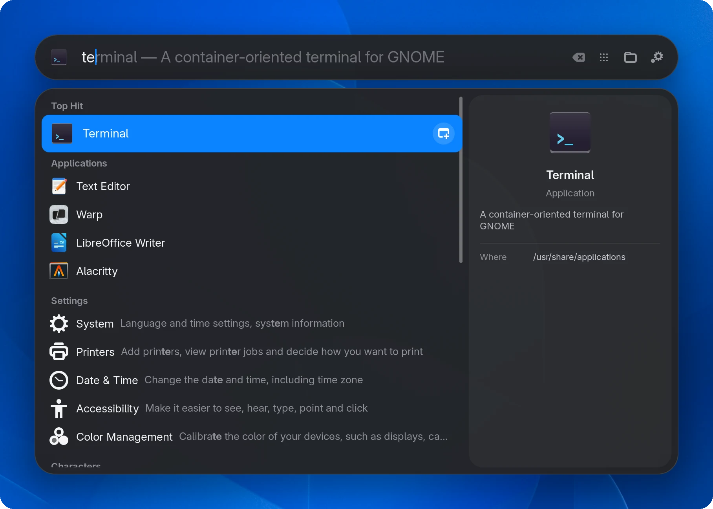
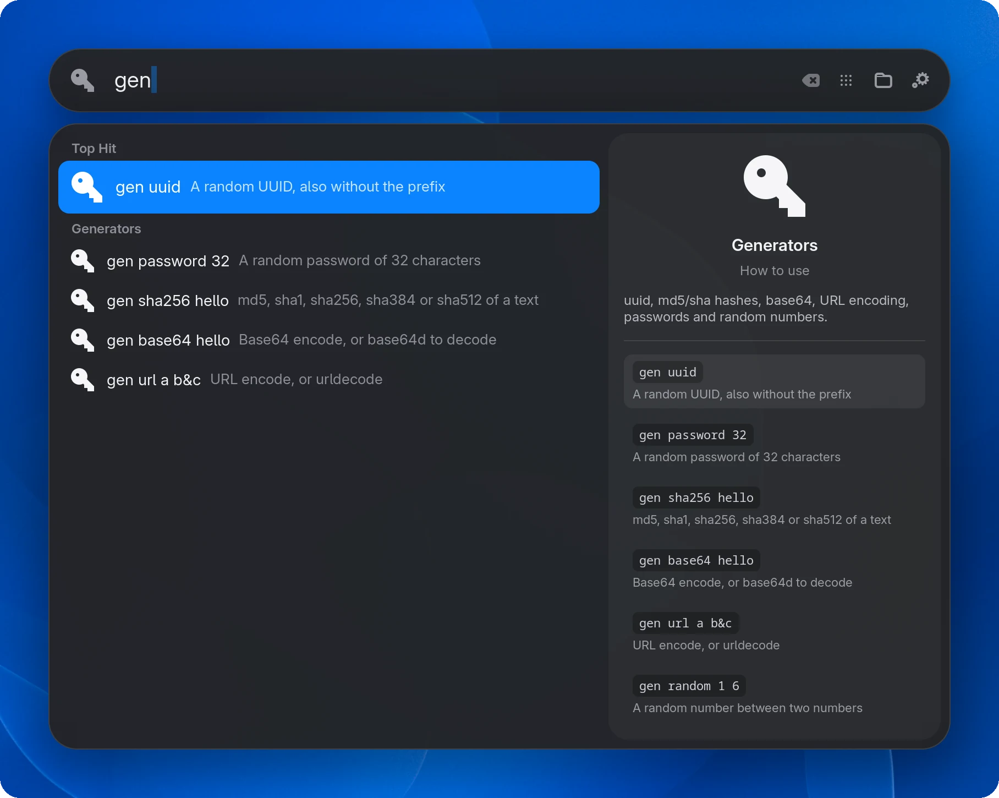
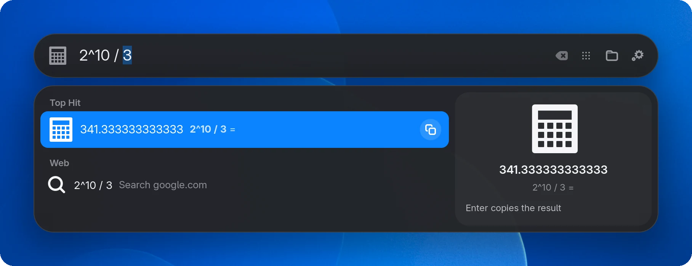
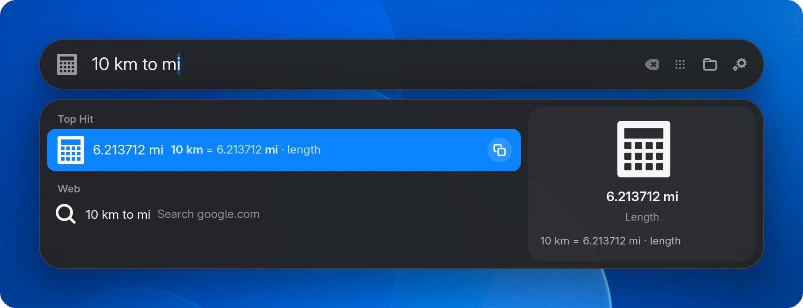
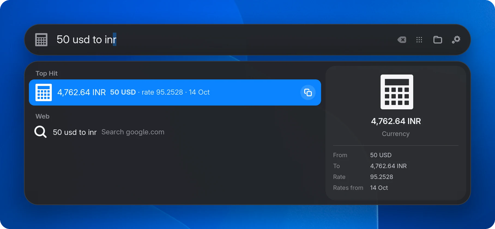
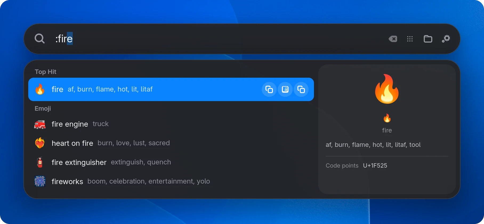
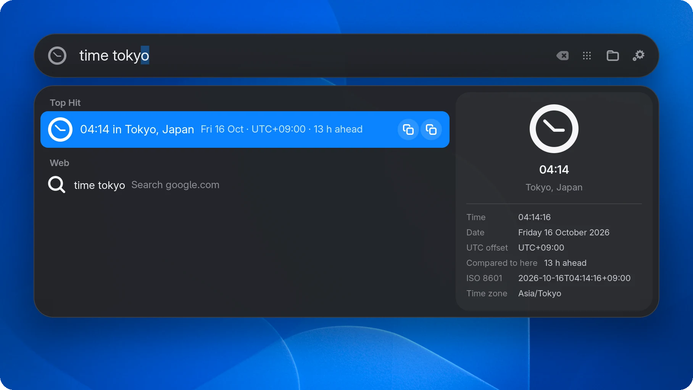
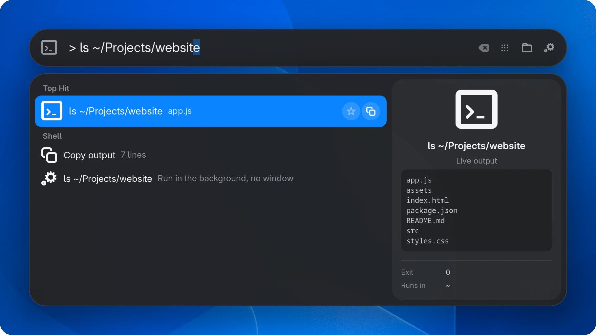
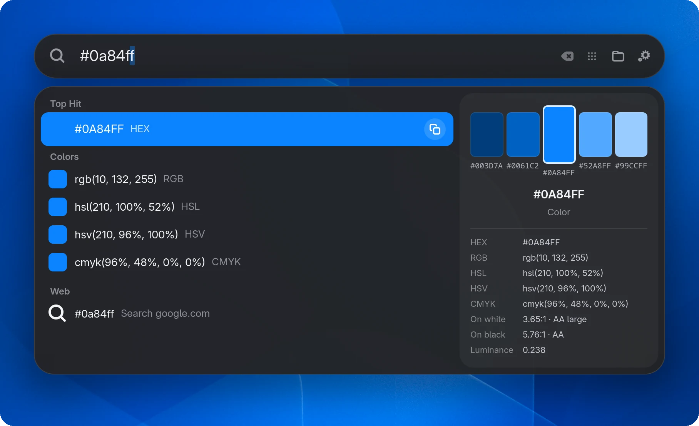
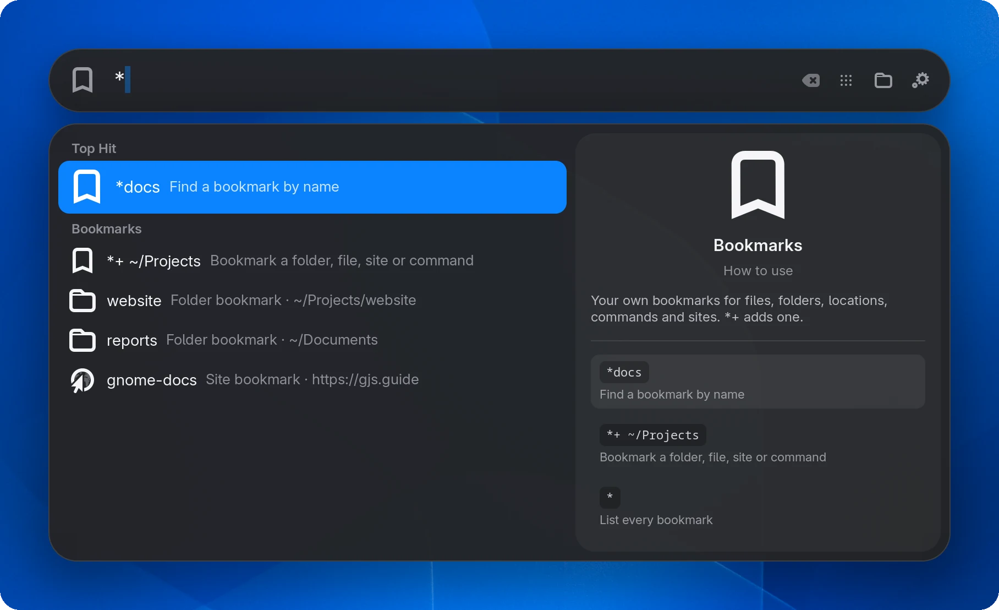

<div align="center">

# QryG Search

**A keyboard-first launcher for GNOME Shell, with plugins and custom styles.**

Pronounced "query-gee". `Super + Space`, type, `Enter`.

[](https://github.com/ru-dr/qryg-search/releases/latest)
[](https://github.com/ru-dr/qryg-search/actions/workflows/ci.yml)
[](LICENSE)
[](#requirements)
[](docs/PLUGINS.md)
[](https://github.com/ru-dr/qryg-search/stargazers)

[Install](#install) · [Usage](#usage) · [Plugins](#plugins) · [Styles](#styles) · [Configure](#configure) · [Wiki](https://github.com/ru-dr/qryg-search/wiki) · [Changelog](CHANGELOG.md)



</div>

## Contents

- [Why](#why)
- [Features](#features)
- [Requirements](#requirements)
- [Install](#install)
- [Usage](#usage)
- [Plugins](#plugins)
- [Styles](#styles)
- [Configure](#configure)
- [Troubleshooting](#troubleshooting)
- [Contributing](#contributing)
- [License and credits](#license-and-credits)

## Why

GNOME's search is good, but it lives inside the Overview. QryG Search replaces it with a floating search bar that opens over any window, even fullscreen video. It also adds the things you would otherwise need five different tools for: a calculator, unit and currency conversion, colour tools, a live shell, bookmarks, clipboard history and fast file search.

Every one of those features is a **plugin**. You can turn each one off, give it your own prefix, or write your own in JavaScript, Python, Bash or anything else that can read and write JSON.

## Features

<p align="center"></p>
<p align="center"><b>Every plugin teaches itself.</b> Type a prefix on its own, like <code>gen </code>, to see what it can do. <code>Tab</code> completes an example and <code>Enter</code> fills it in.</p>

<table>
<tr>
<td width="50%" valign="top"><br><b>Calculator.</b> <code>2^10 / 3</code>, <code>0xff to bin</code>, <code>sqrt 2</code>. No <code>=</code> needed.</td>
<td width="50%" valign="top"><br><b>Units.</b> <code>10 km to mi</code>, <code>1 GiB to MB</code>, <code>72 f to c</code>, in 11 categories.</td>
</tr>
<tr>
<td width="50%" valign="top"><br><b>Currency.</b> <code>50 usd to inr</code>, <code>$20 to eur</code>, with daily rates.</td>
<td width="50%" valign="top"><br><b>Emoji.</b> <code>:fire</code>, <code>:thumbs up</code>. Every emoji, with a skin tone setting.</td>
</tr>
<tr>
<td width="50%" valign="top"><br><b>Time and world clocks.</b> <code>time tokyo</code>, <code>utc+5:30</code>, Unix timestamps.</td>
<td width="50%" valign="top"><br><b>Live shell.</b> <code>&gt; ls</code> shows the output as you type. Only read-only commands run in the preview.</td>
</tr>
<tr>
<td width="50%" valign="top"><br><b>Colours.</b> <code>#0a84ff</code>, <code>rgb()</code>, <code>hsl()</code>: every format, a spectrum and WCAG contrast.</td>
<td width="50%" valign="top"><br><b>Bookmarks.</b> Files, folders, sites and commands. <code>Ctrl + D</code> on any result adds one.</td>
</tr>
</table>

- **Top Hit**, inline completion, a preview pane, and a bar icon that follows the selection
- **15 bundled plugins**, each with a prefix and a built-in usage guide: type a prefix on its own to see how it works
- Filters for Apps, Files, Actions and Clipboard (`Super + 1` to `4`)
- Row actions: open in a new window, show in folder, copy, bookmark
- Fast file search with `plocate`, plus recent files and a live view of your home folders
- Opens over fullscreen apps, and `Super + Space` never leaks a key press into the app behind it
- Uses your system font and follows the light or dark theme, with your own accent colour
- A full CLI (`qryg`) and a preferences window; every change applies live
- Custom styles: drop a CSS file in `~/.config/qryg-search/styles` and it applies as you edit it

## Requirements

- GNOME Shell 48, 49, 50 or 51
- `git` and `python3` for the installer and the `qryg` CLI
- Optional: `plocate` for file search, and the Copyous extension for clipboard history

## Install

```bash
curl -fsSL https://raw.githubusercontent.com/ru-dr/qryg-search/main/install.sh | bash
```

This downloads the latest release to `~/.local/share/qryg-search/src`, installs the extension, and links the `qryg` CLI into `~/.local/bin`. [`install.sh`](install.sh) is short, so feel free to read it first.

Wayland only loads new extensions at login, so log out and back in. Then:

```bash
qryg enable
qryg doctor              # checks dependencies, the shortcut and prefix conflicts
```

<details>
<summary><b>Other ways to install</b></summary>

**From a clone**, to install that checkout:

```bash
git clone https://github.com/ru-dr/qryg-search.git
cd qryg-search
./bin/qryg install       # or --link to symlink it, for development
```

**From the release zip**, without the CLI:

```bash
gnome-extensions install --force qryg-search@ru-dr.shell-extension.zip
```

Download the zip from the [latest release](https://github.com/ru-dr/qryg-search/releases/latest).

**Follow the main branch** instead of releases: put `QRYG_REF=main` before `bash` in the install line.

</details>

### Update

```bash
qryg update --check      # is there a newer release?
qryg update              # install it, then log out and back in
```

### Uninstall

```bash
qryg uninstall           # removes the extension and the CLI link, keeps your settings
```

## Usage

Press `Super + Space` and type. Every source is searched together: apps, files, Settings, and the plugins that recognise what you typed, such as `2^10`, `10 km to mi` or `time tokyo`.

A **prefix** limits the search to one plugin. Symbol prefixes work right away (`>ls`), and word prefixes need a space (`f report`). **Type a prefix on its own to see that plugin's examples**: `Tab` completes the top one and `Enter` fills in the one you pick.

| Prefix | Plugin | Example |
|---|---|---|
| `=` | Calculator | `= 2pi` |
| `conv` | Units | `conv 10 km to mi` |
| `fx` | Currency | `fx 50 usd to inr` |
| `col` | Colours | `col 0a84ff` |
| `tz` | Time and world clocks | `tz tokyo` |
| `gen` | Generators | `gen uuid`, `gen password 32` |
| `>` | Shell | `> git status` |
| `?` | Web | `? gnome shell`, `yt lofi` |
| `*` | Bookmarks | `* docs`, `*+ ~/Projects` adds one |
| `f` | Files | `f invoice` |
| `win` | Open windows | `win firefox` |
| `clip` | Clipboard | `clip password` |
| `:` | Emoji | `:fire`, `:thumbs up` |
| `kill` | Processes | `kill firefox` |
| `session` | Session | `session` lists every action |

Prefixes are yours to change, here or in **Preferences → Plugins**:

```bash
qryg keyword                 # list them
qryg keyword files /         # files now uses "/"
qryg keyword windows none    # no prefix
qryg keyword files default   # back to "f"
```

### Keys

| Key | Action |
|---|---|
| `Super + Space` | Open or close |
| `Super` | Close |
| `Esc` | Clear the filter, then the text, then close |
| `↑` `↓` | Move through results |
| `Tab` or `→` | Accept the inline completion |
| `Enter` | Open or run |
| `Ctrl + Enter` | New window of the selected app |
| `Ctrl + Shift + E` or `Super + Enter` | Show in folder |
| `Ctrl + Shift + C` or `Super + C` | Copy the path or value |
| `Ctrl + D` | Bookmark the selection, or remove a bookmark |
| `Super + 1` to `4` | Apps, Files, Actions, Clipboard filter |
| `Ctrl + Tab`, `Ctrl + Shift + Tab` | Next or previous filter |
| `Backspace` on an empty bar | Clear the filter |

## Plugins

QryG reuses GNOME's **search providers** (apps, Settings panels and anything an app registers, like Files, Calendar or Contacts). Everything else is a QryG plugin.

| Comes from GNOME | QryG plugins (bundled) |
|---|---|
| Apps, Settings, and app search providers | calc, units, currency, colors, generators, time, session, emoji, processes, shell, web, bookmarks, files, windows, clipboard |
| `qryg source` lists and toggles them | `qryg plugin` lists and toggles them |

```bash
qryg source off contacts calendar
qryg plugin disable currency
qryg plugin info time            # prefix, settings and how to use it
```

### Write your own

A plugin is a folder with a `manifest.json` and either a JavaScript module or any executable, in `~/.local/share/qryg-search/plugins/`. It can add results, previews, row buttons and its own settings, which appear in Preferences automatically. Every plugin declares a prefix and a few usage examples:

```json
{
  "id": "hello",
  "name": "Hello",
  "type": "js",
  "main": "plugin.js",
  "keyword": "hello",
  "examples": [["world", "Says hello and copies it"]]
}
```

```js
export default class Hello {
    constructor(api) {
        this.api = api;
    }

    query({query}) {
        const text = `Hello, ${query || 'world'}!`;
        return [{title: text, icon: 'face-smile-symbolic', copy: text}];
    }
}
```

```bash
qryg plugin new weather                          # JavaScript starter
qryg plugin new todo --type script --lang python # or Python, or --lang bash
qryg plugin validate weather                     # check the manifest
qryg plugin test weather paris                   # run one query outside GNOME Shell
qryg plugin reload weather
```

Install other people's plugins from a folder, a git repository, a repository subfolder, an archive or a `manifest.json` link, with the CLI or **Preferences → Plugins → Install a plugin**. Both show what the plugin is and where it comes from before installing:

```bash
qryg plugin install https://github.com/you/plugins/tree/main/weather
qryg plugin update
```

> [!WARNING]
> Plugins run code on your computer. A JavaScript plugin runs inside GNOME Shell with full access to your session; a script plugin runs as your user. Only install plugins from sources you trust, and read the code first.

📘 The [plugin guide](docs/PLUGINS.md) covers the manifest, the API, previews, actions and settings. Working examples are in [`examples/plugins`](examples/plugins).

## Styles

The look is plain CSS. A style is one file in `~/.config/qryg-search/styles/`. Your rules override the built-in look, and every save applies straight away.

```bash
qryg style new mine        # start from an example
qryg style use mine
```

```css
.qryg-search-bar, .qryg-search-results { border-radius: 0; border: 2px solid #ff375f; }
.list-search-result:selected { background-color: rgba(255, 255, 255, 0.12); }
```

🎨 The [style guide](docs/STYLES.md) lists every selector. Examples are in [`examples/styles`](examples/styles).

## Configure

Everything applies live, with no logout. Use **Preferences** (`qryg prefs`) or the CLI:

```bash
qryg                          # status
qryg list                     # every setting
qryg theme dark               # default | dark | light
qryg accent '#ff375f'
qryg shortcut super+space
qryg set width 760
qryg set max-rows 7
qryg set search-engine 'https://duckduckgo.com/?q=%s'
qryg set currencies 'USD, EUR, INR'
qryg set terminal kitty
qryg feature off bounce preview
qryg bookmark add docs ~/Documents
qryg reset --all
```

The full reference is in the [wiki](https://github.com/ru-dr/qryg-search/wiki/CLI-Reference).

## Troubleshooting

| Problem | Fix |
|---|---|
| The bar is invisible, or typing does nothing | Another extension is hiding the Overview search, such as Just Perfection's *Search* option. Turn that option back on. |
| `Super + Space` does nothing | Run `qryg doctor`; it lists anything else bound to the same keys. |
| A new file doesn't show up | plocate reindexes once a day. Run `sudo updatedb` to refresh it now. |
| A plugin doesn't load | It is listed under *Not loaded* in Preferences → Plugins, with the reason. `qryg plugin validate ID` explains it too. |
| Code changes don't apply | On Wayland, GNOME Shell only reloads extension code at login. Settings and plugin reloads are live. |

Logs: `journalctl --user -f -o cat | grep qryg-search`. More in the [wiki](https://github.com/ru-dr/qryg-search/wiki/Troubleshooting).

## Contributing

Issues, plugins, styles and pull requests are welcome. See [CONTRIBUTING.md](CONTRIBUTING.md) for the workflow and release process.

```bash
npm install          # ESLint
make check           # syntax, schema, lint, JavaScript and Python tests
make link            # install this checkout as a symlink
make zip             # build the extension bundle
```

| Path | Contents |
|---|---|
| `lib/core` | Config, paths, patching and stylesheets |
| `lib/overview` | Taking over Overview search |
| `lib/results` | Result list layout and preview |
| `lib/launcher` | The window, keys and actions |
| `lib/plugins` | The plugin host, manifest rules and shared plugin helpers |
| `plugins/` | Bundled plugins |
| `prefs/` | Preferences pages |
| `cli/` | The `qryg` tool |

## License and credits

QryG Search is licensed under [GPL-3.0-or-later](LICENSE).

It started as a fork of [Spotlight](https://github.com/itsnin/spotlight) by itsnin. Built by the community, for the community.
